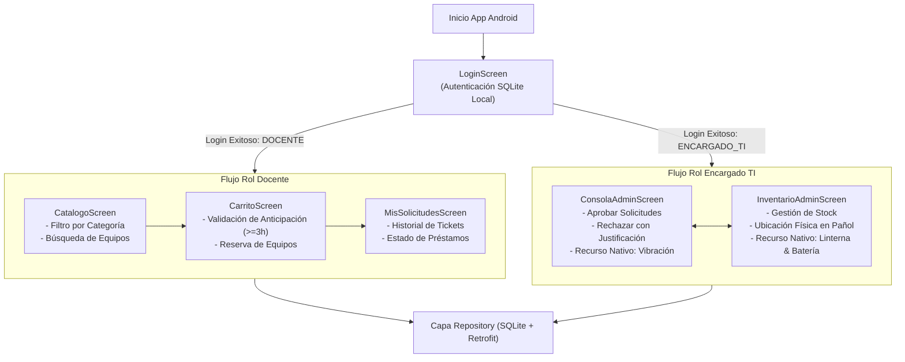

# Diagrama de Arquitectura Android Orientada a Roles

## Descripción
Flujo de navegación y separación funcional de la aplicación Android según el rol del usuario autenticado (`DOCENTE` vs. `ENCARGADO_TI`).

## Características por Rol:
- **Docente**:
  - Consulta del catálogo de equipos del pañol.
  - Creación de solicitudes de reserva en carrito con validación de horas de anticipación.
  - Consulta de estados de sus tickets (Pendiente, Aceptada, Rechazada, Entregada, Devuelta).
- **Encargado TI**:
  - Gestión de inventario y monitoreo de stock disponible.
  - Aprobación/Rechazo de solicitudes ingresadas por docentes.
  - Uso de recursos nativos (Linterna para revisión física de estantes, Vibrador para feedback táctil en decisiones).
