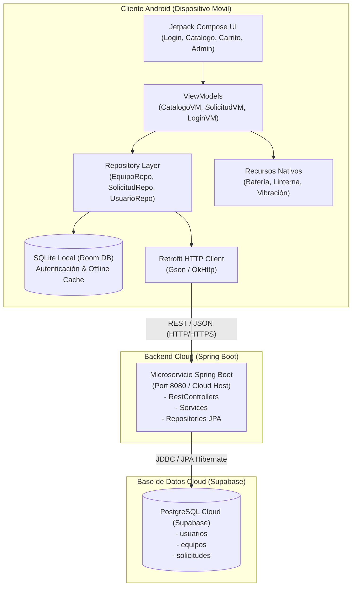

# Diagrama de Arquitectura General del Sistema

## Descripción
Este documento describe la arquitectura general de la solución desarrollada para la Experiencia 3 / Examen Transversal de la asignatura. La arquitectura sigue el patrón **MVVM** en el cliente Android y una **Arquitectura en Capas (Controller-Service-Repository)** en el backend Spring Boot.

## Componentes Clave:
1. **Frontend Android**:
   - Desenvolvido en Kotlin con Jetpack Compose.
   - Implementa el patrón **MVVM** y la capa **Repository**.
   - Gestión de autenticación local y sincronización offline en **SQLite** a través de **Room**.
   - Consumo de microservicios REST por medio de **Retrofit**.
   - Acceso a recursos nativos del dispositivo (`BatteryManager`, `Vibrator`, `CameraManager`).
2. **Backend Spring Boot**:
   - Desarrollado en Java con Spring Boot.
   - Arquitectura por capas (`Controller`, `Service`, `Repository`, `Entity`).
   - Pruebas unitarias mediante **JUnit 5** y **Mockito**.
3. **Base de Datos en Supabase (Cloud)**:
   - PostgreSQL relacional hospedado en Supabase Cloud.
