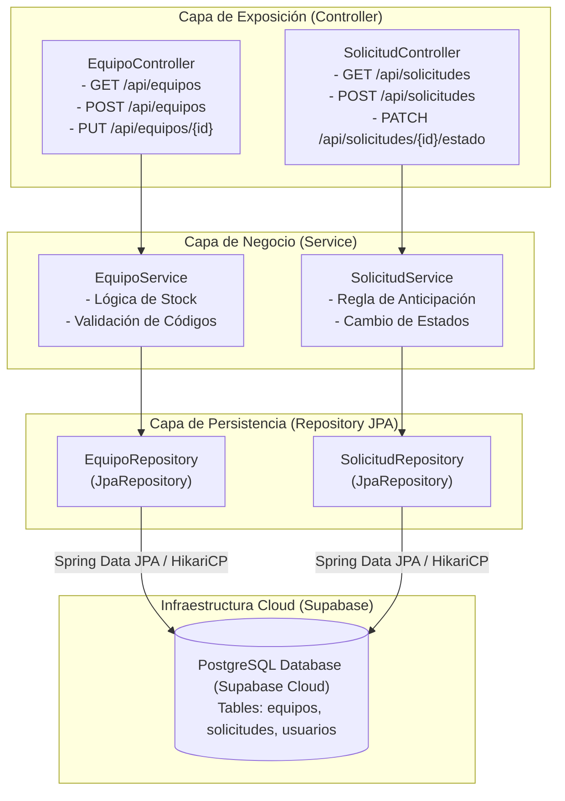

# Diagrama de Arquitectura de Microservicios Backend Spring Boot

## Descripción
Estructura en capas del backend Java Spring Boot y su integración con PostgreSQL en Supabase.

## Pruebas Unitarias Backend (JUnit 5 + Mockito)
Se incluyen pruebas unitarias en `EquipoServiceTest` y `SolicitudServiceTest` para verificar el correcto funcionamiento de los métodos de servicio de forma aislada.
