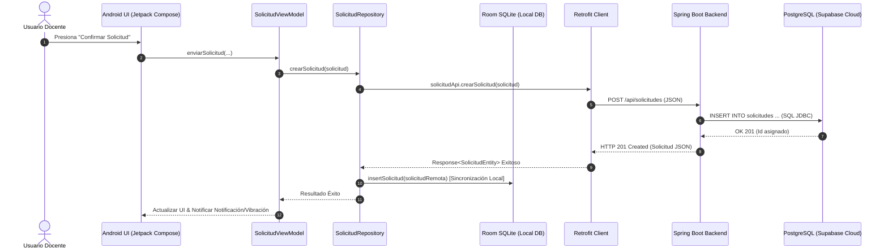

# Diagrama de Comunicación entre Android, Retrofit, Spring Boot y Supabase PostgreSQL

## Descripción
Flujo completo de interacción extremo a extremo entre el cliente móvil, la capa Retrofit, el backend Spring Boot y la base de datos PostgreSQL alojada en Supabase Cloud.

